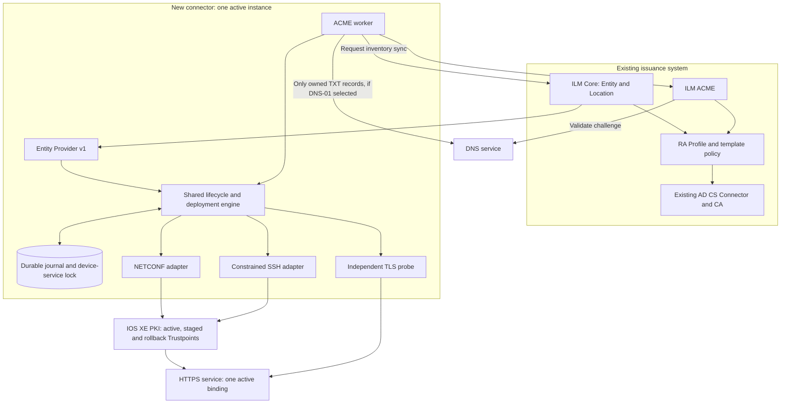
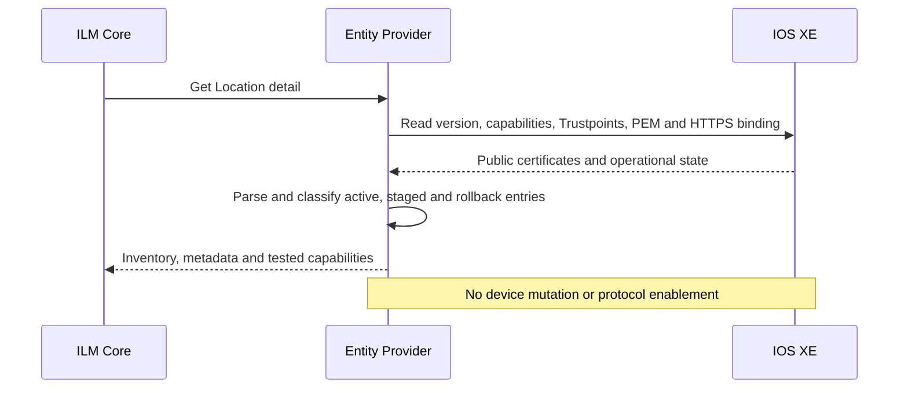

# Architecture

Scope: OmniTrust ILM 2.19.0 Entity Provider v1, Cisco C8000V HTTPS and Microsoft
AD CS. The HTTP boundary and read-only Entity Provider with SQLite metadata
are implemented; device transports, issuance and deployment remain planned.
Names and network details below are synthetic.



Each operation selects its transport from discovered and tested capabilities.
NETCONF models alone do not prove that CSR extraction or inline certificate
import is usable. Constrained CLI fills verified gaps; RESTCONF is a later
adapter. gNOI is outside the initial baseline.

A device is an Entity. Its HTTPS service is one stable Location, even when
the Trustpoint changes. Multiple inventory entries do not mean multiple active
HTTPS bindings. Certificate keys stay on the device; the ACME account key is
a different connector secret.

## Discovery



## ACME renewal and deployment

```mermaid
sequenceDiagram
    participant Worker as ACME worker
    participant Engine as Shared engine
    participant Journal as Durable journal
    participant Device as IOS XE
    participant Issuer as ILM ACME and AD CS
    participant Probe as Independent TLS probe
    Worker->>Engine: Renew stable HTTPS Location
    Engine->>Journal: Acquire service lock; persist preflight baseline
    Engine->>Device: Create independent non-exportable staging key and CSR
    Device-->>Engine: CSR only
    Engine->>Engine: Check CSR signature, key policy and SAN
    Engine-->>Worker: CSR and operation ID
    Worker->>Issuer: Reuse or create order; challenge; finalize external CSR
    Issuer-->>Worker: Leaf and chain
    Worker->>Engine: Stage operation certificate
    Engine->>Engine: Check key match, SAN, EKU, validity and approved chain
    Engine->>Device: Import to inactive managed Trustpoint
    Engine->>Journal: STAGED
    Note over Engine,Device: Initial lab milestone stops here
    opt Activation gate has been satisfied
        Engine->>Journal: Persist SWITCHING intent before write
        Engine->>Device: Bind HTTPS to staged Trustpoint
        Engine->>Probe: Fresh TLS connection, target address and SNI
        alt New certificate and chain verified
            Engine->>Device: Persist only after concurrent-change checks
            Engine->>Journal: COMMITTED
        else Verification failed or outcome uncertain
            Engine->>Device: Reconcile actual binding; restore old binding if possible
            Engine->>Probe: Verify old certificate on fresh connection
            Engine->>Journal: ROLLED_BACK or NEEDS_OPERATOR
        end
    end
    Engine-->>Worker: Final observed result
```

## Alternative native ILM renewal

```mermaid
sequenceDiagram
    participant Core as ILM Core
    participant API as Entity Provider v1
    participant Engine as Shared engine
    participant CA as RA Profile and AD CS
    Core->>API: Generate CSR with Location and CSR attributes
    API->>Engine: Require renewalOwner=ilm-core; lock service
    Engine-->>API: Device CSR, operation metadata and pushAttributes
    API-->>Core: Base64 DER CSR and correlated pushAttributes
    Core->>CA: Issue through RA policy
    CA-->>Core: Issued certificate
    Core->>API: Subsequent push with certificate and operation attributes
    API->>Engine: Verify operation; stage or activate according to policy
    Engine-->>Core: Observed deployment result and metadata
```

Native Core renewal and the ACME worker are mutually exclusive per Location.
Core native renewal calls RA/Authority directly; it is not an ACME client.
The ACME worker gets its CSR through the in-process engine, not an invented
public Core CSR endpoint. Core push has no chain field in the pinned contract;
use an approved public CA bundle reference.

## State and recovery invariants

`PRECHECK → CSR_READY → AWAITING_ISSUANCE → CERT_READY → STAGED → SWITCHING →
ACTIVE_VERIFIED → COMMITTED` is the success path. Failure states include
`FAILED_NO_SWITCH`, `ROLLED_BACK`, `ACTIVE_NOT_PERSISTED` and `NEEDS_OPERATOR`.

- One durable device/service lock covers API and worker mutations. Initial
  deployment uses one active process and a dedicated SQLite WAL volume.
- Persist intent before irreversible side effects. After a timeout or restart,
  observe the actual device before retrying. No blind key regeneration or
  ACME resubmission.
- Retain the old Trustpoint, certificate and key for rollback. Do not remove
  active or recovery resources through Core cleanup calls.
- Certificate import, live TLS activation and configuration persistence are
  separate outcomes. NETCONF rollback is not a transaction over device keys
  and certificate stores.
- A global save can persist other administrators' changes. Detect conflicting
  edits and stop for reconciliation. Do not restore an entire old config.
- Pin SSH host identity and validate TLS hostname/chain. Independent recovery
  access and a synchronized clock are prerequisites for write acceptance.

## Evidence

- [ILM interfaces 2.19.0](https://github.com/OmniTrustILM/interfaces/tree/e62233777518296f70a151cf766dde5e1a6cea2d)
- [Official Go SDK v1.1.0](https://github.com/OmniTrustILM/go-sdk/tree/v1.1.0)
- [Cisco IOS XE CA-signed certificate workflow](https://www.cisco.com/c/en/us/support/docs/security-vpn/public-key-infrastructure-pki/220422-configure-ca-signed-certificates-with-io.html)
- [Cisco C8000V YANG set, 26.1 reference](https://github.com/YangModels/yang/tree/main/vendor/cisco/xe/2611)

Model and documentation coverage is a design input. Actual advertised schemas,
AAA behavior and operation results must be recorded in private lab evidence.
