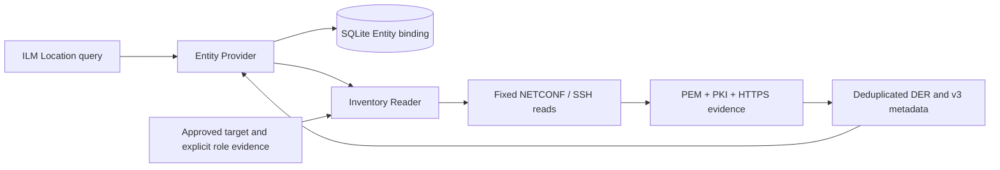

# Certificate inventory — backlog #5

`internal/inventory` connects the read-only transport library to the existing
Entity Provider. It makes no device changes, does not call Core or ACME, and
does not add cached certificates or operation state to SQLite. The host must
still provide credentials, pinned identities, HTTP authentication and a runnable
application. Actual C8000V/Core acceptance remains separate (#6 / L-001).



## Evidence and completeness

All five successful reads from #4 are required. The version must contain one
IOS XE version header. This identifies the output family; it is not a claim
that a firmware version, schema, AAA policy or time configuration is supported.
Formats outside the implemented subset return `ErrUnsupported`; missing or
contradictory data returns `ErrIncomplete`. Neither error returns partial
certificates or raw transcripts. The Provider reports 502, or 504 for a
transport deadline/cancellation, preserving the existing service Location ID.

| Input | Evidence used |
|---|---|
| PEM CLI | Explicit `------Trustpoint: NAME------` group, CA/general-purpose purpose marker, complete base64 DER and X.509 parsing |
| CLI PKI | Unique `Trustpoint NAME:` groups with indented descriptive fields; group set must match PEM |
| NETCONF PKI | Pinned model namespace, unique bundle labels, complete certificate metadata matching each DER by serial, CA flag and MD5 fingerprint; any reported associations must match PEM |
| HTTPS binding | Exactly one explicit CLI secure-trustpoint or exact namespaced NETCONF native/ip/http/secure-trustpoint path |
| HTTP state | Enabled secure server, valid port and the same unique Trustpoint as the separate binding read |

MD5 is only a consistency check against Cisco's published metadata. SHA-256
from the full DER identifies certificates and explicit role assignments. MD5,
serial number, subject name, list order and key-generated flags are never
used as trust, private-key or activity proofs.

CRLF/LF, surrounding whitespace, PEM base64 line widths and a leading command
echo/trailing prompt are supported. CA-only notices are supported when a
complete CA certificate is present. Paging, control characters, unknown `%`
messages, failed CA export, truncation, unknown purpose markers, naked PEM,
duplicate groups/certificates and namespace/schema mismatches fail closed.
Empty/unenrolled groups without complete certificate evidence are incomplete.
The first version requires all observed Trustpoint groups to be accounted for;
it does not silently drop unreadable unrelated groups.

Each response is bounded to 4 MiB, each DER to 1 MiB, total certificate
occurrences to 128 and Trustpoints to 64. XML has a 64-level depth bound and
100,000-element bound; directives, foreign nodes, duplicate attributes,
ambiguous envelopes and duplicate required leaves are rejected.

## Roles and private-key limits

| Role | Required evidence |
|---|---|
| ACTIVE | The sole leaf under the explicit binding, confirmed by HTTP state |
| STAGED | An operator/journal assignment pinned to Trustpoint plus SHA-256; Trustpoint belongs to the approved staging pool |
| ROLLBACK | The same explicit assignment, in the staging pool or the configured baseline active Trustpoint, currently inactive |
| INACTIVE | A leaf with no active binding or matching explicit assignment |
| CA | Parsed X.509 CA flag, consistent with the PEM purpose marker |

Assignments accept only STAGED/ROLLBACK. A missing certificate, changed
fingerprint, duplicate assignment, unapproved slot or active/rollback conflict
fails the read. The constructor copies assignments; there is no writable
assignment API. No durable journal exists yet: future lifecycle work must
provide operation ownership evidence. Names alone never imply roles.
Multiple identity certificates in one Trustpoint (for example separate
signature/encryption or native rollover) are explicitly unsupported; the
parser will not choose an HTTPS leaf by order.

ACTIVE describes agreement between management reads. Reads are sequential,
not an atomic device snapshot or independent TLS handshake. Chain validity,
expiry, SAN/EKU policy, revocation, clock correctness and actual wire-served
certificate verification remain later gates. Any observed contradiction fails
this read, but an intervening change cannot be ruled out by these reads alone.

No current read proves that an individual certificate has an associated
private key. `tp-keys-generated=true` is insufficient. The adapter supplies
`withKey=false` conservatively plus explicit `keyAssociation=UNKNOWN` metadata;
this must not be used as evidence that the device lacks its key or can renew.
Key management remains disabled; CSR/push/remove routes remain 501 and are
not advertised. No private key is exported, stored or generated.

## Provider mapping and host wiring

The adapter checks `DeviceAccess` against `device.Client.ApprovedTarget`
before collecting: device ID, literal address, credential reference and primary
host-key reference must match the immutable transport registry. NETCONF is
the primary daemon when configured; otherwise CLI is primary. A separate CLI
pin is fixed in that same registry. The host must construct both registries
from its approved configuration; requests cannot supply endpoints or pins.

```go
// client: *device.Client from the operator's immutable transport registry.
// assignments: map[deviceID][]inventory.Assignment, with verified public hashes.
reader, err := inventory.NewReader(client, assignments)
// Handle err before continuing.
handler, err := provider.NewReadOnlyHandler(store, cfg, reader)
// Handle err; mount only behind the host's authenticated transport.
```

Offline `Parse` returns one observation per certificate/Trustpoint occurrence.
The Reader deduplicates identical DER for ILM, retaining every occurrence in
sorted `trustpointRoles` metadata (`NAME=ROLE`). Other metadata are
`certificateKind`, `sha256Fingerprint` and `keyAssociation`. Stable metadata
UUID suffixes are 0201–0204 under the existing attribute namespace. Metadata
uses numeric version 3, schemaVersion v3, type meta, string content, local
scope and overwrite semantics from the pinned ILM 2.19.0 sources. No extra
Location fields, mutable attributes or invented wire enum values are added.
Core's actual metadata rendering/merge behavior remains untested.

## Validation and sources

D-003, D-004 and D-005 now have executable synthetic CLI/NETCONF evidence.
Integration uses real temporary SQLite and the official SDK's in-process
HTTP handler, with a synthetic collector. Separate #4 tests exercise actual
loopback SSH/NETCONF servers and the fixed command/RPC allowlist. There is
no live device test in this item. Generated test keys and certificates exist
only at runtime; real transcripts and fingerprints must remain private.

- [Cisco PEM and Trustpoint command formats](https://www.cisco.com/c/en/us/td/docs/ios-xml/ios/security/s1/sec-s1-cr-book/sec-cr-s3.html)
- [Cisco HTTPS state and binding fields](https://www.cisco.com/c/en/us/td/docs/ios-xml/ios/https/configuration/xe-16-9/https-xe-16-9-book/HTTPS--HTTP_Server_and_Client_with_SSL_3-0.html) (field-format evidence only; legacy cipher examples are not policy recommendations)
- [Pinned 26.1 YANG paths and hashes](../contracts/iosxe-26.1-reference.json)
- [Pinned 2.19.0 MetadataAttributeV3](https://github.com/OmniTrustILM/interfaces/blob/e62233777518296f70a151cf766dde5e1a6cea2d/src/main/java/com/otilm/api/model/common/attribute/v3/MetadataAttributeV3.java)
- [Pinned 2.19.0 metadata properties](https://github.com/OmniTrustILM/interfaces/blob/e62233777518296f70a151cf766dde5e1a6cea2d/src/main/java/com/otilm/api/model/common/attribute/common/properties/MetadataAttributeProperties.java)
