# Durable operation journal — backlog #7

`internal/journal` persists operation correlation, state transitions and HTTPS
service ownership in a dedicated SQLite database. `internal/lifecycle.ImportGate`
is the shared internal API/worker import entry point. The import gate uses a
counting test adapter; real import, private issuance acceptance, scheduling and HTTP lifecycle
wiring remain later milestones. The read-only Provider returns 501 for mutations.
The subsequent [CSR component](device-csr.md) adds schema v2 public CSR artifacts,
atomic generation intent/result recording and an opt-in SSH adapter; the import
adapter and activation paths remain future work.
The [certificate gate](certificate-policy.md) now binds a validated leaf to the
recorded CSR and approved issuance policy before CERT_READY.
The [external-CSR ACME workflow](acme-external-csr.md) adds schema v3 public
account/order association, separate CAS progress and retry timestamps. It keeps
the original CSR and order across timeouts/restarts. The [AD DNS backend](ad-dns01.md)
adds schema v4 challenge ownership, separate markers and CAS update/cleanup
intents. Actual KDC/AD DNS and resolver acceptance remains private #15.

## Ownership and correlation

The host supplies reviewed `Service` configuration to `journal.Open`. A service
binds the persisted Entity UUID and deterministic `HTTPSLocationID` to one device
ID, literal management address, pinned SSH host-key SHA-256, policy SHA-256,
`Owner` (`ilm-core` or `acme-worker`) and approved staging names. The host must
derive this configuration from registered entities and approved effective policy;
these are internal types, not extra ILM DTO fields or caller-provided permissions.
The copied staging pool cannot be expanded by later caller mutation.

`Begin` also records the observed active Trustpoint, original leaf SHA-256 and
selected staging name. It generates an unpredictable operation UUID and persists
a separate unique request UUID. Repeating that request with identical correlation
returns the same record; changing any correlation value is rejected. A partial
unique index permits one unfinished operation per stable Location. Different
services can progress while one service is waiting on its importer.

`Ref` contains the operation UUID and full immutable correlation. Every operation
lookup checks the current host policy and the stored correlation, including
device identity, owner, original fingerprint and staging name. Revisions provide
compare-and-swap for progression. The operation UUID is a correlation identifier,
not a bearer credential; the future host must authenticate and authorize callers
and construct these references from its own records, not trust request claims.

Changing owner, policy or staging pool while an unfinished operation exists
fails startup. With no unfinished work, a new reviewed owner/policy is permitted;
old references then fail current-policy checks. Device/entity/address/host-key
rebinding is never silently accepted; an explicit migration remains future work.
Missing configuration for an unfinished service also blocks startup.

## Durable boundaries

```mermaid
stateDiagram-v2
    [*] --> PRECHECK: unique request / service ownership
    PRECHECK --> FAILED_NO_SWITCH: abort before any mutation intent
    PRECHECK --> KEY_CREATING: persist key intent
    KEY_CREATING --> CSR_READY: CSR engine records verified public artifacts
    CSR_READY --> AWAITING_ISSUANCE
    AWAITING_ISSUANCE --> CERT_READY: validator receipt binds certificate SHA256
    CERT_READY --> IMPORTING: commit intent before dispatch
    IMPORTING --> STAGED: importer succeeds and completion commits
    IMPORTING --> IMPORTING: uncertain result / restart; no redispatch
```



Each state change and its history event commit in one transaction. The database
uses WAL, `synchronous=FULL`, foreign keys, bounded busy handling and one SQL
connection. Startup checks application/schema identifiers, SQLite integrity and
agreement between each operation and its committed history. Foreign, corrupt,
unsupported or inconsistent databases are rejected, never reset. Failed commits
do not authorize a callback. WAL/FULL durability still depends on the filesystem
and storage honoring synchronization requests. See [SQLite WAL](https://www.sqlite.org/wal.html)
and [synchronous semantics](https://www.sqlite.org/pragma.html#pragma_synchronous).

Only a PRECHECK with no mutation intent can be aborted and release service
ownership. KEY_CREATING, unresolved IMPORTING and STAGED retain ownership across
close, restart and elapsed time. There is no TTL that lets a second worker enter
while a previous device operation might still be running. Activation, rollback,
verified reconciliation and their terminal states will extend this schema in
their own milestones; they are not synthesized by this journal.

## Import gate

```mermaid
sequenceDiagram
    participant Caller as API / worker
    participant Gate as Shared ImportGate
    participant DB as Journal
    participant Importer as Later validated import adapter
    Caller->>Gate: operation reference + validated certificate digest
    Gate->>DB: Validate correlation; commit IMPORTING + event
    alt Intent commit fails
        DB-->>Gate: storage error
        Gate-->>Caller: no importer call
    else Already STAGED with identical digest
        DB-->>Gate: recorded STAGED result
        Gate-->>Caller: same result; no importer call
    else Already IMPORTING
        DB-->>Gate: reconciliation required
        Gate-->>Caller: retain ownership; no importer call
    else New committed intent
        Gate->>Importer: one import call using recorded target/staging slot
        alt Import succeeds and completion commits
            Gate->>DB: STAGED + event
            Gate-->>Caller: STAGED
        else Error, timeout, crash or completion write failure
            Gate-->>Caller: unresolved IMPORTING; retain ownership
        end
    end
```

`CertificateReady` is retained for the digest-only foundation harness and rejects
operations with a recorded CSR. Runtime `CertificateValidated` requires a fresh
opaque certificate-policy receipt matching the saved CSR and approved policy,
and atomically commits CERT_READY with its history. The shared certificate gate
revalidates time and enrollment evidence even on repeated acceptance. No receipt
or permission grant is restored from SQLite. Before production import, #12 must
recheck the actual leaf/policy evidence, device key and baseline. The importer must
honor context deadlines and return only when it has stopped issuing requests; it
must not start detached background writes or call `Store.Close` itself.

Concurrent duplicate pushes do not dispatch another import. A completed retry
returns recorded STAGED for the identical certificate; uncertain/importing retries
return `ErrReconcile`. That recorded result is not a fresh device observation.
An error is never treated as proof that the device did nothing. The next staging
milestone must independently inspect actual device state before recording a
reconciled result; this milestone deliberately leaves uncertain work blocked.

## Single active instance and storage boundary

Opening the same database takes a nonblocking OS lock on the actual file handle
for the lifetime of the Store. Linux uses `flock`; Windows uses `LockFileEx` on a
byte range beyond SQLite's maximum database size. Closing waits for dispatched
import callbacks and completion recording before releasing the lock. A killed
process releases the OS lock while durable service ownership survives. The lock
file is never deleted or replaced. Hard-linked files, database symlinks and
unsupported platforms are rejected. See [Windows lock semantics](https://learn.microsoft.com/en-us/windows/win32/api/fileapi/nf-fileapi-lockfileex)
and [SQLite database limits](https://www.sqlite.org/limits.html).

Use one canonical private local path/volume. Multiple copies of the database,
multiple hosts, shared/network filesystems, filesystem replacement of a live
database and HA operation are unsupported. No OS lock can coordinate independent
database copies. Only the connector may edit the live database; external SQL
connections in tests are deliberate failure injection. Backups must preserve
SQLite consistency including the WAL. Keep private directories owner-only; on
Windows configure an ACL, since Go's 0700/0600 mode bits do not establish one.

Entity metadata remains in its existing separate store. Operation records contain
identity/digest correlation and state; DNS claims additionally contain short-lived
challenge TXT values and random markers for reference-only cleanup. They contain no certificate private keys,
passwords, raw transcripts or arbitrary diagnostic error text. They are still
private operational data. No new public workflow, credential input or live test
is added by this item.

## Executable evidence

T-001/T-002/T-003/T-009 use real temporary SQLite files and the narrow lifecycle
gate with a counting importer. Tests cover 24 begin contenders, owner conflict,
16 overlapping pushes, same/different certificates, restart readback, persisted
locks, revision replay and cross-device/policy/baseline forgeries. A subprocess
is killed after committing IMPORTING; reopening recovers the intent without
redispatch. Shutdown cannot release the instance lock during an import.

Storage tests use `query_only`, another writer, cancellation, closed storage and
an actual SQLite page limit producing `SQLITE_FULL`; an import-state trigger
forces allocation during the intent transaction. A failed completion write is
also tested. None of these scenarios may produce another importer call or an
uncommitted STAGED result. Detached state/history, unsafe configuration and file
aliases are rejected. These assertions validate storage and dispatch behavior;
they do not establish real router import compatibility or later recovery logic.
