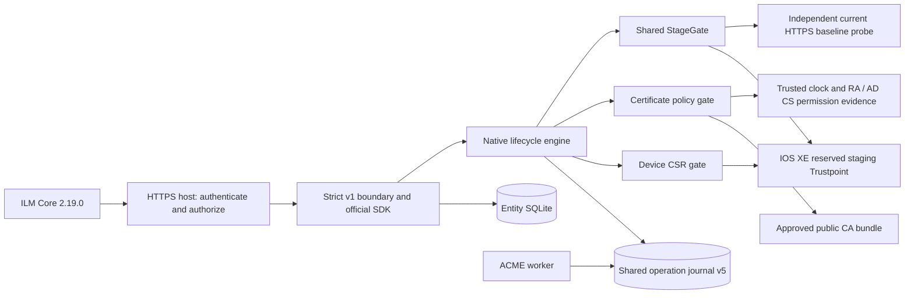

# Native ILM Core lifecycle — backlog #13

`provider.NewNativeHandler` is an explicit, authenticated host integration point.
`nativeflow.Engine` implements its lifecycle port using the shared CSR,
certificate-policy and stage-only gates. `NewReadOnlyHandler` and the existing
read-only executable retain their original capabilities. No new server or live
write command is introduced here; credential/service hosting is #14 and private
Core/router acceptance is #15, including C-009.

## Source contract and capabilities

[Pinned Core 2.19.0 LocationServiceImpl](https://github.com/OmniTrustILM/core/blob/eb5e9096fb0b7ff56c911184ff8601c615f83436/src/main/java/com/otilm/core/service/impl/LocationServiceImpl.java)
checks `supportKeyManagement` before native issue/renewal. This flag means that
the Location can generate a device CSR; it does not mean private-key export.
The native handler reports it only for an approved `ilm-core` service, and lists
CSR/push routes in Info. The read-only handler reports false and hides those
routes. Both retain `multipleEntries=true` because the active certificate and
the candidate coexist. Remove-certificate remains 501. Entity deletion is also
501 in native mode to preserve stable operation associations.

Core sends `renewal=false` for issue and true for renewal, passes the returned
Base64 DER CSR to its RA issuance/renewal service, and saves the returned
`pushAttributes`. It can push immediately or after pending issuance completes.
The connector's CSR response includes read-only operation metadata plus a v3
`operationId` request attribute. Later push carries the leaf and that attribute;
there is no chain field or public, independent Core CSR endpoint. Unknown fields,
v2 attributes, replacement scopes and invented chain input are rejected before
the lifecycle engine. Definitions use numeric `version=3` and `schemaVersion=v3`;
request attributes use `version=v3`. Successful per-entity validators return 204.

The source pins and observed Core flow are recorded in
[`contracts/core-native-2.19.0-reference.json`](../contracts/core-native-2.19.0-reference.json).
The independent Java interface fixtures remain under `contracts/ilm-2.19.0`.

## Components and boundary



The trusted host creates/preserves the Entity first and then binds its UUID and
deterministic HTTPS Location ID to an approved device address, SSH host key,
owner, issuance-policy digest, observed active Trustpoint/certificate baseline,
reserved staging Trustpoint and normalized CSR specification. None of these
values is selected through Core input except the already approved staging name.
`nativeflow.New` refuses a CSR specification outside its certificate policy.

The host must share one `journal.Store` among API and worker entry points and
wire `lifecycle.NewIOSXECSRGate`, `NewCertificateGate` and `NewIOSXEStageGate` to
that store. Use real inventory/TLS, synchronized clock and current permission
evidence providers. A configured `acme-worker` Location cannot be opened as a
native service. Retained PRECHECK/key/import/STAGED work cannot be taken over by
changing owner, configuration or a caller-supplied UUID.

`NewNativeHandler` requires a non-nil host callback that authenticates **and
authorizes every request**, before routing, Entity lookup or device work. It
does not interpret an operation ID as authentication, and no default allow
callback is supplied. Test-only allow callbacks are not deployable host examples.
The host must provide HTTPS and enforce its approved Core identity and scopes;
#14 supplies the credential, audit and service-host boundary. Internal adapter
errors never become HTTP diagnostics: scope is 403, policy 422, reconciliation
409, timeout 504 and unavailability 500. Secrets/raw device output are omitted.

## Durable request and push sequence

```mermaid
sequenceDiagram
    participant C as ILM Core
    participant A as Authenticated SDK boundary
    participant N as Native engine
    participant J as SQLite journal
    participant D as IOS XE CSR / Stage gates
    participant R as Core RA / Authority
    C->>A: CSR(locationAttributes, csrAttributes, renewal)
    A->>N: Server-resolved Entity / HTTPS Location scope
    N->>J: Begin(stable trusted-intent request ID)
    J-->>N: Existing operation or new PRECHECK
    N->>D: Generate CSR (durable KEY_CREATING before device work)
    D-->>N: Validated public CSR, or reconciliation required
    N->>J: AWAITING_ISSUANCE
    N-->>C: Base64 DER CSR, metadata, v3 operationId pushAttributes
    C->>R: Issue or renew using the exact CSR
    R-->>C: Issued leaf, possibly after pending approval
    C->>A: Push(leaf, saved pushAttributes, locationAttributes)
    A->>N: Approved server scope plus untrusted operation UUID
    N->>J: Resolve durable correlation inside current ILM Core binding
    N->>N: Validate CSR, CA bundle, template, clock and permission evidence
    N->>D: Stage exact leaf; reuse approved public CA bundle
    D->>J: Commit IMPORTING before import dispatch
    D->>D: Read back exact key/issuer/leaf and probe old HTTPS
    D->>J: Commit STAGED only with fresh proof
    N-->>C: withKey=true, operationState=STAGED
    Note over N,D: No HTTPS switch, configuration save, key export or cleanup
```

The CSR protocol has no caller request-id. The engine derives a namespaced UUID
from the complete trusted service intent, normalized CSR spec and renewal flag.
The existing persisted `operations.request_id` and service uniqueness constraints
provide restart/concurrency safety without another SQLite schema. Identical
requests reuse the exact CSR while issuance is pending. A changed renewal flag
or intent conflicts with retained work. KEY_CREATING with an unknown result
requires reconciliation; it never regenerates the key. A completed import does
not allow another CSR/issuance round before the future activation/closure flow.

Push resolves its UUID within the server-selected Binding, checks the saved
correlation and native intent ID, and reuses the common CertificateGate and
StageGate. Leaf-only chains resolve from the server-approved public CA bundle;
missing/ambiguous bundles fail validation. Every successful push, including
duplicates and restart retries, obtains current StageGate key/TLS/policy proof.
IMPORTING retries only inspect/reconcile; a partial import retains ownership and
cannot dispatch another import. `withKey` is never inferred from STAGED alone.

Location synchronization recovers CSR/push attribute definitions only for an
observed leaf with a matching, server-approved STAGED native operation. It does
not infer live key presence from that association. Existing manually installed
certificates have no native association and are not automatically adopted. Their
adoption, actual RA/template mapping and first Core-driven renewal are private
acceptance work. STAGED is an inactive installation result; Core must not treat
successful push as proof that the new HTTPS certificate is serving.

## Executable evidence and remaining acceptance

Offline tests use the actual SDK boundary, temporary Entity/journal SQLite,
runtime CSR/CA/leaf material and the real policy/stage gates. They exercise CSR
correlation across restart, leaf-only Core push, approved bundle resolution,
owner/scope rejection, changed intent, concurrent lost CSR replies, lost/partial
imports, duplicate pushes, restored inventory attributes and missing current key
proof. Import counts and the unchanged old HTTPS baseline are asserted.

S-007 is implemented by this joint test. C-009 remains planned until a real Core
2.19.0 accepts registration, authentication, validators and the native issue /
pending-push / renewal lifecycle. Actual IOS XE prompt semantics, command
permissions, deferred NTP, CA/RA/template mapping, AD CS enrollment rights,
approved CA layout and recovery access are #15/L-002 prerequisites. No real
device, ILM instance, CA or DNS service was contacted by these tests.
