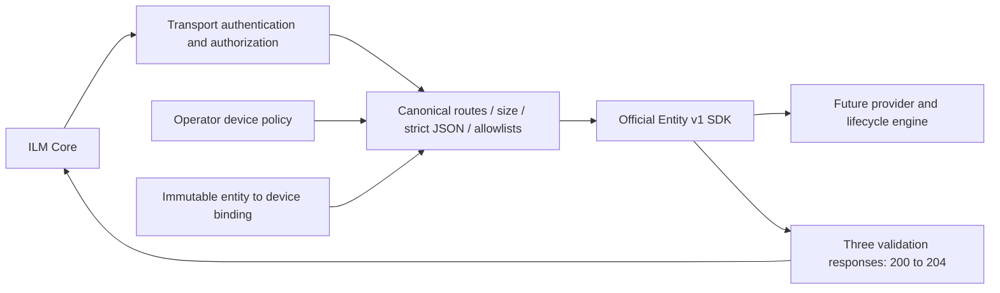

# ILM v1 boundary — backlog #2

`internal/provider.NewBoundary(next, Config)` wraps the official Go SDK
v1.1.0 handler. This is an HTTP library, with no listener, credentials,
persistence, issuer, command execution or device connection of its own. The
[read-only Provider](readonly-provider.md) now supplies Entity storage,
attribute-definition DTOs and capability advertisement. Do not deploy the SDK
test backend as a connector.

## Request flow



Authentication must wrap the boundary. Configure the SDK explicitly with
`WithInfoVersion(VersionV1)`, `WithHealthVersion(VersionV1)` and
`WithErrorRenderer(WriteV1Error)`. Register the attribute providers with the
SDK's `WithKindAttributes`, `WithLocationAttributes`,
`WithPushCertificateAttributes` and `WithGenerateCsrAttributes`; the SDK
otherwise returns empty definitions/bare validation success by default.
The read-only Provider supplies these implementations. This library does not
authenticate a caller or advertise a deployable capability on its own.

Every entity-scoped route resolves the canonical entity UUID to an approved
device ID. `EntityResolver` must use the caller's context, be safe for
concurrent calls and return an immutable device binding. Unknown/unapproved
bindings fail with 404; resolver errors return a generic 500. The future
storage layer must enforce that immutability transactionally. An entity
update may change its display name, but cannot rebind it to another device.

## Operator policy and request attributes

`Config.Devices` maps an operator-owned device ID to one literal management
IP, an active Trustpoint name and zero or more staging names. The constructor
copies the map and slices. Addresses must be global unicast (including private
management addresses), with no loopback, link-local, zone, mapped IPv4 alias
or duplicate address. Requests cannot supply URLs, hostnames, proxy settings,
ports, commands, credentials or arbitrary connection targets.

Device IDs and Trustpoint names use `[A-Za-z0-9][A-Za-z0-9_.-]{0,63}`.
Staging names must be unique and distinct from the configured active name,
including case variants. An empty staging pool disables CSR attribute
acceptance. This is a static policy check: actual active/rollback roles,
slot occupancy, AAA permissions and YANG capabilities must still be checked
on the device before writes in later milestones.

All attributes below are required in their respective arrays, with exactly
one `string` content item and `version: "v3"`. Array order is immaterial;
duplicate, null, missing or unknown attributes/properties fail with 422.
Both attribute and content `contentType` must be `string`. Values are bounded
to 128 bytes before their more specific checks. v2, other subtypes and
`reference` indirection are deliberately unsupported in this first subset.

| Scope | Name | Stable UUID | Value |
|---|---|---|---|
| Entity/kind | `deviceId` | `4c198a4c-0f9a-4b65-a378-1a8996a20101` | Exact approved device ID |
| Entity/kind | `targetAddress` | `4c198a4c-0f9a-4b65-a378-1a8996a20102` | Canonical IP string equal to that device's approved target |
| Location | `service` | `4c198a4c-0f9a-4b65-a378-1a8996a20103` | `https` |
| CSR | `stagingTrustpoint` | `4c198a4c-0f9a-4b65-a378-1a8996a20104` | Exact member of that entity's approved staging pool |
| Push | `operationId` | `4c198a4c-0f9a-4b65-a378-1a8996a20105` | Canonical lowercase, non-nil UUID |

For example, a Location attribute is:

```json
[{"uuid":"4c198a4c-0f9a-4b65-a378-1a8996a20103","name":"service","contentType":"string","version":"v3","content":[{"contentType":"string","data":"https"}]}]
```

Push validates the UUID's **syntax only**. Durable operation ownership,
expected device/key/fingerprint, replay prevention and authorization remain
T-003 and must be enforced by the journal/lifecycle backend. A syntactically
valid operation ID is never evidence that an import is authorized.

## HTTP contract

The wrapper admits only the pinned v1 Entity route subset plus the SDK's
`iosxe` kind-attribute routes. Encoded/cleaned path aliases, noncanonical UUIDs,
query strings, unknown methods and unknown routes fail before the SDK.
GET/DELETE bodies are rejected. JSON requests require unencoded
`application/json`, a single UTF-8 JSON value, unique object keys at every
level, nesting at most 16 and exact case-sensitive envelope field names.
The request limit defaults to 1 MiB and may be set up to 4 MiB; configure
the SDK's request limit consistently if changing it. The exact checked
bytes are passed to the SDK without generated DTOs acting as the allowlist.

| Body | Required keys | Optional keys |
|---|---|---|
| Entity create/update | `name`, `kind`, `attributes` | None |
| Location detail | `locationAttributes` | None |
| CSR | `locationAttributes`, `csrAttributes`, `renewal` (boolean) | None |
| Push | `certificate`, `locationAttributes`, `pushAttributes` | `certificateType` (`X.509` only) |

Entity kind is `iosxe`. The display name is 1–128 bytes, with no control
characters or surrounding whitespace; it is not a CLI token. Push accepts
nonempty canonical standard Base64 wire data only, with no line breaks.
This is **not X.509 semantic validation**. The future backend must verify
the issued leaf, recorded CSR, SAN/EKU, validity, key and approved CA chain.
The pinned push DTO has no `chain` field. Certificate removal returns 501
until protected-resource/journal checks exist; it never reaches the backend.
Entity deletion is metadata management only and must not remove device keys.

The DTO's annotation says default `X509`, but the pinned
[`CertificateType` enum](https://github.com/OmniTrustILM/interfaces/blob/e62233777518296f70a151cf766dde5e1a6cea2d/src/main/java/com/otilm/api/model/core/certificate/CertificateType.java)
uses `@JsonValue` with `X.509`. The boundary and SDK integration test use this
actual wire value and reject `X509`; omission remains accepted.

Successful per-entity Location/CSR/Push **attribute validators** return 204
with no body or Content-Length. The kind validator retains 200. The adapter
does not buffer responses and leaves 400/403/422/500 responses untouched.
Boundary-generated 400/404/405/413/415/500/501 errors use the v1 `message`
envelope; policy violations use the v1 422 string array. It does not echo
raw request values or resolver errors. Backend errors use the configured SDK
v1 renderer, including the v1 authentication envelope for 403.

## Evidence and remaining acceptance

`internal/provider/boundary_test.go` uses the **real SDK HTTP handler** plus
a call-counting backend with no external I/O. Its negative tests assert zero
backend calls, rather than checking status alone. It covers target 204,
kind 200, v1 info/health/errors, unknown fields at every used level, all
five attribute identities, injection, cross-device updates/staging,
IPv4/IPv6, malformed/duplicate/deep JSON, media/size limits, copied policy,
resolver failures and concurrent requests.

The first commit contains the tests and a passthrough scaffold. Running it
fails on target 204, unknown-property rejection, scope isolation and request
limits. The following implementation makes those assertions pass. Upstream
characterization tests in `tests/contract` remain unchanged.

Catalog C-010–C-013 and D-009–D-016 describe this offline evidence. C-009
remains planned until actual ILM 2.19.0 registration and native lifecycle
acceptance; D-008 remains planned until the adapters also enforce the input
policy at their device boundary. There are no real Core, router or issuance
results in this milestone. HTTP acceptance alone must not enable writes.
